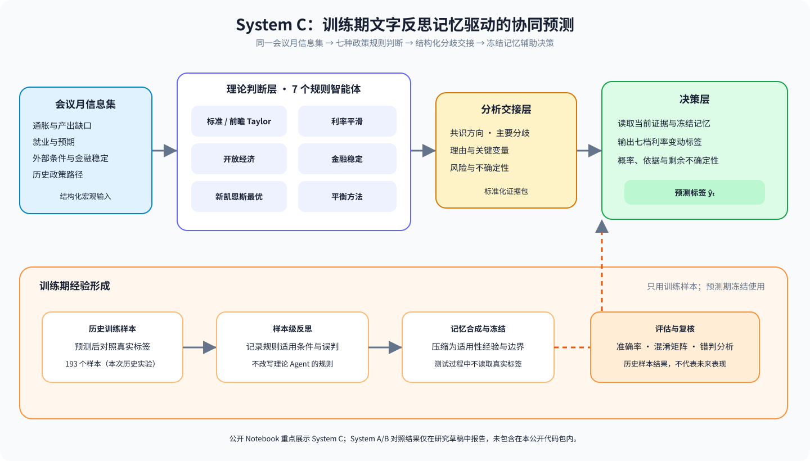

# 美联储利率决议预测：多智能体协同框架

这是一个围绕 FOMC 利率决议分类预测构建的研究原型。公开代码展示 System C：七类货币政策规则智能体先独立判断，分析层整理共识与分歧，决策层结合训练期形成并冻结的文字反思记忆输出七档利率变动标签。



## 项目成果

本地归档的一次 System C 历史实验覆盖 2015—2025 年的 83 个会议月份，七分类准确率为 **75.9%（63/83）**，宏平均 F1 为 **0.645**。零变动类别占 52/83，因此多数类基准准确率为 **62.7%**；将标签合并为加息、维持、降息三类后，方向准确率为 **80.7%**。这些数字来自完整的本地逐样本结果摘要，不是从公开仓库重新运行得到的结果。详细口径、对照实验和限制见[结果说明](docs/results.md)。

这组结果适合展示研究过程和实验观察，不足以证明方法对其他时期、数据版本或实时决策具有同等表现。当前代码使用修订后的宏观序列，且公开包未包含原始数据；因此项目不将其描述为严格的实时回测，也不宣称优于通用预测基准。

## 方法与实现

- **任务：** 预测会议月份对应的联邦基金目标利率变动区间，使用七档标签。
- **理论判断层：** 标准 Taylor、前瞻性 Taylor、利率平滑、平衡方法、开放经济、金融稳定和新凯恩斯最优规则。
- **分析交接层：** 汇总预测分布、理由、关键变量、理论共识、分歧和风险提示。
- **决策层：** 读取当前证据与冻结的训练期文字记忆，输出最终标签、概率分布及理由。
- **训练边界：** 训练期在样本预测后使用真实标签形成反思；进入测试期后记忆冻结，不用测试期标签更新。

完整说明见[系统架构](docs/architecture.md)。公开 Notebook 聚焦 System C；论文草稿中的 System A/B 对照结果没有作为对应实现一并公开。

从工程上，项目把样本构造、七类理论输入路由、输出结构校验、分析交接、决策和训练记忆冻结串成可追踪的预测流程，并通过结果摘要支持错判分析。

## 结果图


图中横轴为会议月份。当前运行记录将日期编码为每月 1 日，因此它表示月份索引，不是 FOMC 的精确会议日期。图表可由 `scripts/render_results.py` 从仓库内的精简结果表重新生成。

## 数据与复现

公开仓库不附带原始宏观数据、模型调用日志或逐条推理文本。运行所需数据文件名和字段、已核对的数据来源、频率与变换见[数据来源说明](docs/data_sources.md)和[data 准备说明](data/README.md)。发布原始序列前仍需确认各发布机构的共享条款；注明来源不等于自动获得再分发许可。

需要 Python 3.10 或更高版本。Windows PowerShell 示例：

```powershell
python -m venv .venv
.\.venv\Scripts\Activate.ps1
python -m pip install -r requirements.txt
Copy-Item .env.example .env
jupyter notebook
```

在本地 `.env` 中设置 `DEEPSEEK_API_KEY`，打开 `rate_decision_system_c.ipynb` 并按顺序运行。Notebook 默认不会自动开始训练或预测。训练反思和推理会将样本内容发送给配置的模型服务；先确认数据使用权限并评估调用成本，不要提交 `.env`、密钥或本地运行产物。

## 目录

```text
public/
├── README.md
├── rate_decision_system_c.ipynb
├── requirements.txt
├── .env.example
├── data/                         # 本地准备数据，不随仓库发布
├── docs/
│   ├── architecture.md
│   ├── data_sources.md
│   ├── results.md
│   └── assets/                   # 架构图与实验结果图
├── results/
│   └── system_c_predictions_by_month.csv
└── scripts/
    └── render_results.py
```


## 许可证

当前公开仓库尚未选择许可证。代码可公开浏览，但这不等于明确授权他人再分发、改编或商用；正式按开源项目发布前，需要选择并添加许可证。数据源条款另行适用。