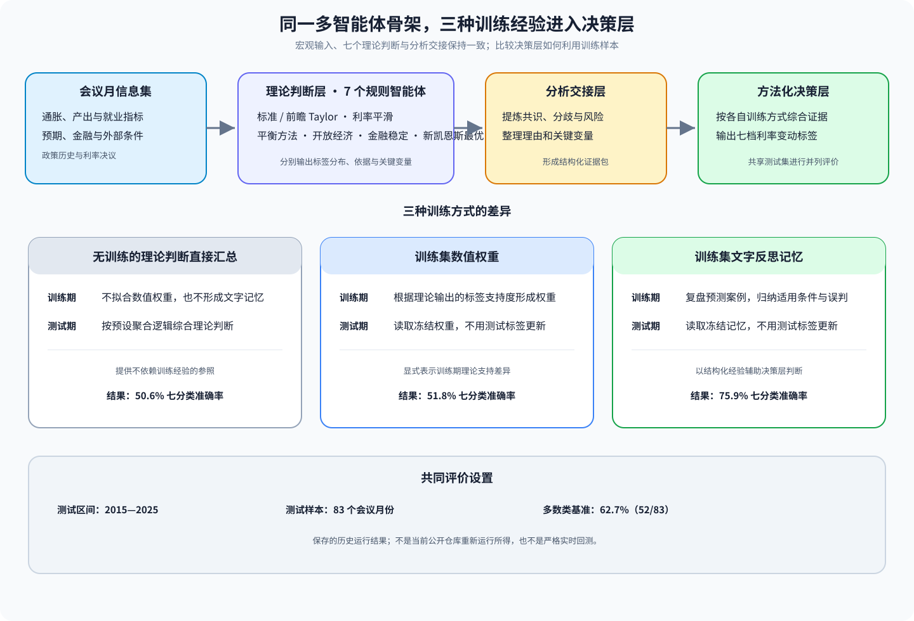
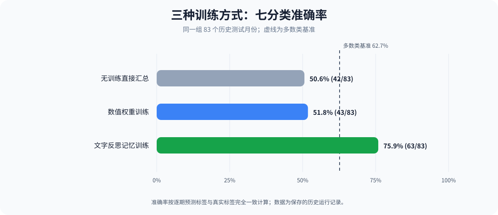
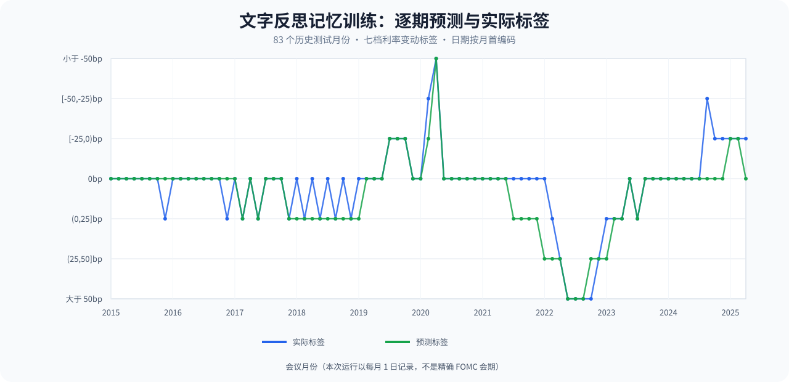
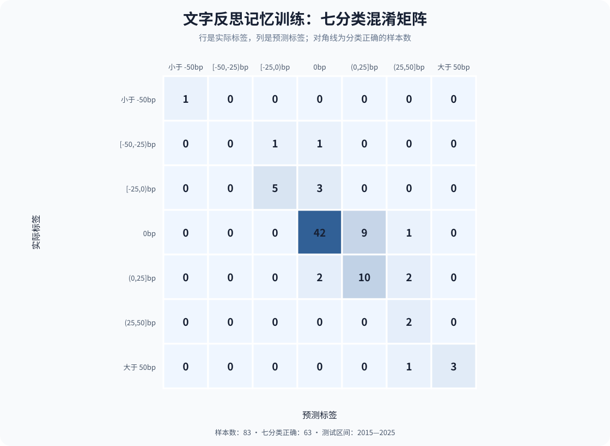

# 美联储利率决议预测：多智能体协同框架

这是一个用于研究货币政策理论智能体如何协同预测美联储利率变动区间的实验项目。项目把同一套宏观信息集、七个理论判断智能体和分析交接层，与三种不同的决策训练方式组合起来，比较训练期经验如何影响测试期输出。



## 项目内容

- 三份可审阅的完整 Notebook，分别展示无训练直接汇总、训练集数值权重和训练集文字反思记忆。
- 七分类标签定义、决议月份样本构造、理论规则智能体、分析证据交接、模型接口、运行追踪和结果汇总逻辑。
- 83 个测试月份的三种方法逐期预测结果，以及可从结果表重新生成的图表。
- 数据来源、字段口径、研究设计和限制说明。

## 三种训练方式

| 方法 | 训练阶段 | 测试阶段的决策依据 |
|---|---|---|
| [无训练直接汇总](notebooks/01_direct_aggregation_no_training.ipynb) | 不更新数值权重或文字记忆 | 按预设聚合逻辑汇总理论判断 |
| [训练集数值权重](notebooks/02_training_set_numeric_weights.ipynb) | 根据理论输出对训练期真实标签的支持情况形成数值权重 | 读取冻结的理论权重 |
| [训练集文字反思记忆](notebooks/03_training_set_reflection_memory.ipynb) | 对训练样本的预测误差和适用条件形成结构化文字经验 | 读取冻结的文字记忆，不使用测试标签更新 |

三个 Notebook 的文件名和说明直接写明训练方式。方法差异与共同流程详见[方法说明](docs/methods.md)和[系统架构](docs/architecture.md)。

## 历史实验结果

三种方法在同一批 83 个测试月份上逐期对齐，测试区间为 2015—2025 年。准确率分别为：无训练直接汇总 **50.6%（42/83）**、数值权重训练 **51.8%（43/83）**、文字反思记忆训练 **75.9%（63/83）**。由于真实标签中 `0bp` 占 **52/83**，多数类基准为 **62.7%**；因此前两种方法低于多数类基准，第三种方法高于该基准。



准确率并不完整反映类别不平衡。对照宏平均 F1、平衡准确率和三分类方向准确率，及其口径和限制，见[结果说明](docs/results.md)。这些是保存的历史运行结果，不是从此公开仓库重新运行所得，也不构成实时预测能力或普遍有效性的证明。

逐期标签：[下载 CSV](results/three_training_methods_predictions_by_month.csv)。图表生成方式见 `scripts/render_results.py`。

## 系统结构与图表





横轴按会议月份展示；现存运行记录以每月 1 日编码，日期并非精确 FOMC 会议日。

## 数据与复现

仓库**不包含原始宏观数据、工作簿、训练/推理请求与响应日志、缓存或历史备份**。输入来源涉及多个发布机构和第三方序列，来源标注不自动代表拥有再分发权；此外，项目目录中的原始数据文件并不齐全到足以构成可独立复现的输入包。请依照[数据来源说明](docs/data_sources.md)自行核对并准备有权使用的数据，文件布局见 [`data/README.md`](data/README.md)。

需要 Python 3.10 或更高版本。Windows PowerShell 示例：

```powershell
python -m venv .venv
.\.venv\Scripts\Activate.ps1
python -m pip install -r requirements.txt
Copy-Item .env.example .env
# 编辑 .env，填写自己的 DEEPSEEK_API_KEY
jupyter notebook
```

在仓库根目录打开所需 Notebook。输入文件应放在 `data/` 下。默认不会发起模型调用；若要实际训练/预测，请先阅读 Notebook 说明、确认数据可发送至模型服务，并在启动 Jupyter 前设置 `$env:RUN_EXPERIMENT="1"`，再运行最后一个单元格。一次完整运行会产生模型服务调用费用。请勿提交 `.env`、密钥、私有数据或运行产物。

## 目录结构

```text
public/
├── README.md
├── notebooks/                     # 三种训练方式的完整 Notebook
├── requirements.txt
├── .env.example
├── data/README.md                 # 本地输入布局与准备要求
├── docs/
│   ├── architecture.md
│   ├── methods.md
│   ├── data_sources.md
│   ├── results.md
│   └── assets/                    # 架构图、对照图与误差图
├── results/
│   └── three_training_methods_predictions_by_month.csv
└── scripts/
    └── render_results.py
```

## 许可证

仓库尚未选择许可证。公开浏览不等于授予再分发、改编或商用权限；数据源还受各自条款约束。
