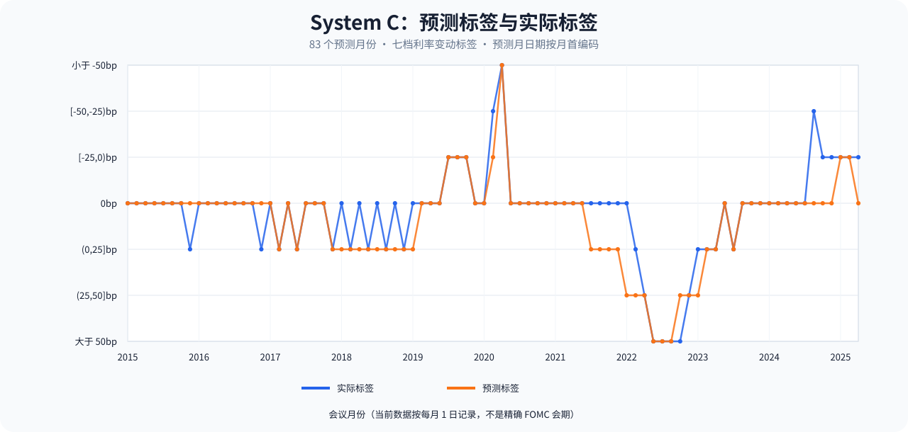
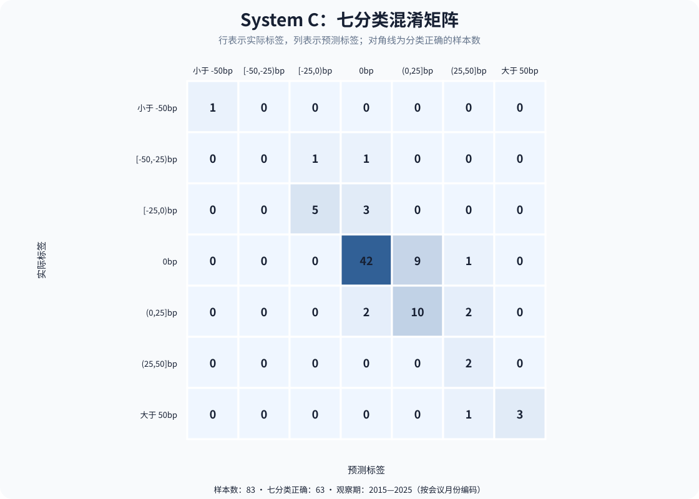
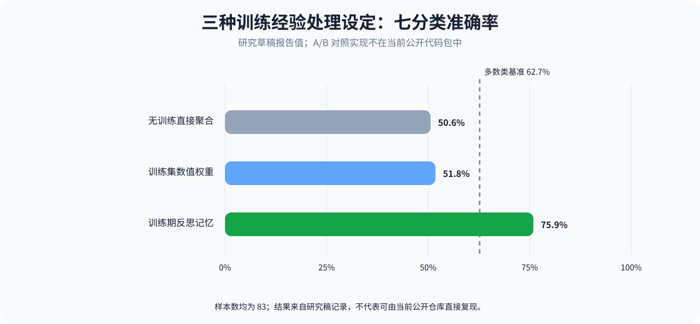

# 实验结果与解释边界

## System C：归档预测结果

下面的 System C 指标由原项目完整预测历史中的 83 条 `prediction_vs_actual.csv` 记录整理。公开结果表只保留会议月份、真实标签和预测标签；没有宏观输入值、推理解释、模型请求日志或密钥。公开 Notebook 不含输入数据和模型调用结果，因此读者目前不能仅靠克隆仓库复现这些数值。

| 指标 | 结果 | 口径 |
|---|---:|---|
| 七分类准确率 | 75.9%（63/83） | 七档标签完全一致 |
| 多数类基准 | 62.7%（52/83） | 每次都预测样本占比最大的 `0bp` 类 |
| 七分类宏平均 F1 | 0.645 | 七个固定类别的 F1 等权平均 |
| 七分类平衡准确率 | 0.700 | 七个固定类别召回率的等权平均 |
| 三分类方向准确率 | 80.7%（67/83） | 合并为降息 / 维持 / 加息 |

## 研究草稿中的对照结果

研究草稿报告了三类设定在同一 83 个样本上的七分类准确率。A/B 对照实现没有包含在当前公开 Notebook 中，以下数值作为研究稿报告结果展示，不应表述为本仓库可直接复现的对照实验。

| 设定 | 正确数 / 样本数 | 草稿报告准确率 |
|---|---:|---:|
| 无训练直接聚合 | 42 / 83 | 50.6% |
| 训练集数值权重 | 43 / 83 | 51.8% |
| 训练期反思记忆（System C） | 63 / 83 | 75.9% |

这些结果支持将“如何把训练期经验交给决策层”作为实验观察重点；它们不单独证明文字记忆导致了普遍性能提升。当前公开包缺少 A/B 代码、原始数据版本和逐指标发布日期，且模型服务输出可能随版本变化。进一步比较应在固定数据、模型版本、调用设置和评估代码下复跑，并报告类别不均衡下的宏平均指标及不确定性。

## 样本与日期口径

系统 C 的归档结果覆盖 2015 年 1 月至 2025 年 12 月，共 83 个决议月份。结果文件中的日期统一为每月 1 日，是月份索引，不是 FOMC 的精确会议日期。七档标签的真实类别数为：`<-50bp` 1、`[-50,-25)bp` 2、`[-25,0)bp` 8、`0bp` 52、`(0,25]bp` 14、`(25,50]bp` 2、`>50bp` 4。

预测期间隔为 2015-01-01，训练样本 193 条。历史数据的修订版本、宏观数据发布日期和月份映射方式会影响“会议前可得信息”的判断；当前实验不是经过 vintage 数据验证的严格实时回测。图表由 `scripts/render_results.py` 从精简结果表生成。
